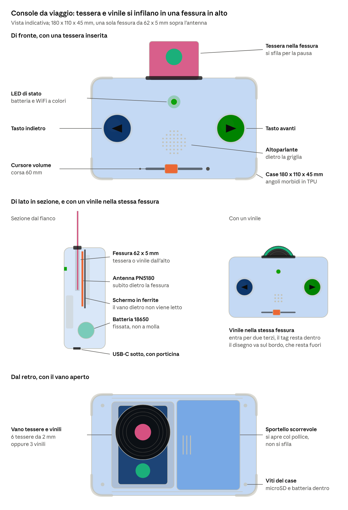

# Variante v3 — console da viaggio

**Stato:** variante esplorata il 18 ottobre 2026 e **modellata la sera stessa**,
perché la stampa non era ancora partita: gli STL sono in
`modelli-3d/v2-console/` e il confronto con il cubo sta nel suo README.
Non sostituisce il progetto principale finché non si decide di adottarla.

**Cambiato rispetto a questo documento:** la carta si infila **di lato corto**
lasciandone fuori un centimetro, non a metà di lato lungo. Così la spira del
tag, che corre lungo tutto il bordo della CR80, finisce tutta davanti
all'antenna e la lettura smette di essere un'incognita; e la tasca scende da
78 a 50 mm di profondità. Anche il coperchio del vano è cambiato: a scatto
invece che scorrevole, perché 96 × 64 non passa dal calibro delle parti
piccole e una corsa da 96 mm non ci stava nella console.

*Vista indicativa: di fronte con una tessera inserita, sezione laterale, con un disco nella fessura, dal retro con il vano aperto.*

## L'idea

Una console orizzontale da tenere con due mani. Tessere e dischi non si appoggiano sul coperchio: **si infilano in un'unica fessura sul bordo superiore**, con l'antenna del PN5180 subito dietro. Sfilarli mette in pausa, come togliere la carta dal cubo: il comportamento del firmware non cambia.

## Misure e disposizione

| Elemento | Dove | Misure |
| --- | --- | --- |
| Case | — | 180 × 110 × 45 mm, angoli in TPU |
| Fessura | bordo superiore, al centro | 62 × 5 mm, profonda circa 47 mm |
| Tasto indietro / avanti | frontale, sinistra / destra, sotto i pollici | arcade 30 mm |
| LED di stato | frontale, in alto al centro | WS2812B singolo |
| Altoparlante | frontale, al centro dietro la griglia | Ø40 mm |
| Cursore volume | frontale, in basso | corsa 60 mm |
| USB-C | bordo inferiore, con porticina scorrevole | — |
| Vano tessere e dischi | retro, con sportello scorrevole | interno circa 64 × 90 × 14 mm |
| MicroSD, batteria | dentro, dietro le viti del case | — |

## Fessura, tessere e dischi

- **Tessera:** entra per circa 45 mm e ne sporgono 40 con il disegno, come una cartuccia.
- **Disco:** il tag è al centro, quindi il disco deve entrare per circa due terzi. Il disegno va sul bordo, che resta fuori. In alternativa, nella console anche la musica può stare su tessere con un bordo di colore diverso.
- **Tessere di PVC già pronte (CR80):** l'antenna del tag corre lungo il bordo della carta, quindi a metà inserita ne resta fuori una parte. La lettura va provata con il provino NFC; se è incerta, si usano tessere stampate da 2 mm con il tag adesivo da 25 mm nella metà che entra.
- **Pulizia:** un bambino ci infila di tutto (monete, briciole). La fessura va fatta passante o con il fondo apribile.

## Vano sul retro

- Sportello scorrevole su due guide, con scatto di chiusura e fermo: si apre col pollice e non si sfila, quindi nessun pezzo staccabile.
- Contiene 6 tessere da 2 mm, oppure 3 dischi da 4 mm, oppure un misto (per esempio 4 tessere e 1 disco). Tessere di PVC: circa 10.
- Per farlo stare lo spessore passa da 35 a 45 mm.
- **Schermo in ferrite** dietro l'antenna del PN5180: senza, il lettore potrebbe leggere le tessere nel vano e far partire una storia da solo. Di solito migliora anche la lettura verso la fessura.

## Niente display: LED di stato

Il display e-paper è tolto per costo, come nel progetto principale. Al suo posto un solo LED RGB WS2812B (pochi centesimi) sul GPIO 12, libero da quando è stato tolto il display (vedi `hardware/pinout.md`):

- colore della batteria al risveglio (verde / giallo / rosso);
- WiFi attivo e modalità setup;
- nanna attiva (controllo genitori).

ESPuino gestisce già un anello di LED WS2812: va configurato con un solo LED (da verificare nel fork). Titolo e traccia si vedono dalla web UI; i suoni di sistema restano.

## Cosa cambia rispetto al cubo

| | Cubo (progetto principale) | Console v3 |
| --- | --- | --- |
| Lettura | carta o disco appoggiati sul coperchio | carta o disco infilati nella fessura |
| Raccolta | raccoglitori laterali (6 carte, 6 dischi) | vano sul retro (6 tessere o 3 dischi) |
| Componenti in più | — | schermo in ferrite NFC, LED WS2812B, filamento TPU per gli angoli |
| Portabatteria | a molla | con fermo o fascetta: resta sostituibile ma non si stacca negli urti |
| Firmware | — | solo la configurazione del LED |
| Stampa 3D | scocca, piatto NFC, raccoglitori | scocca con fessura, guida e sportello del vano, angoli TPU: più lavoro |

## Da verificare prima di sceglierla

- [ ] Lettura affidabile di tessere PVC inserite a metà (provino con fessura)
- [ ] Il PN5180 con schermo in ferrite non legge le tessere nel vano
- [ ] Risveglio con LPCD quando si infila la tessera
- [ ] Il disco entra e si sfila senza incastrarsi; nessun oggetto resta bloccato nella fessura
- [ ] Caduta da 1 m con gli angoli in TPU, batteria che non si stacca
- [ ] Peso e presa per mani di un bambino di 2–3 anni
