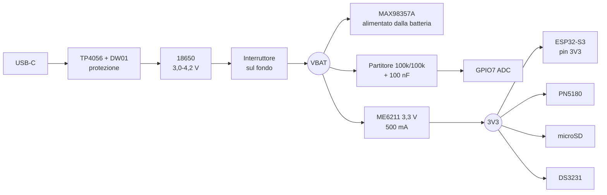

# Schema di cablaggio

Questo documento **è** lo schema per il montaggio su millefori della 1.0:
collegamento per collegamento, con le insidie note. Il progetto KiCad
(`kicad/`) si disegna quando il prototipo funziona davvero, per la M6.

I numeri dei GPIO vengono da [`pinout.md`](pinout.md), che resta l'unica fonte
di verità: se qui e lì non coincidono, vale `pinout.md`.

## Alimentazione

Quattro regole che evitano guai:

1. **Si carica a box spento.** L'interruttore stacca tutto il carico, il
   TP4056 vede solo la cella e chiude bene la carica. È la ricarica notturna
   prevista dalle specifiche, non serve il load sharing.
2. **Quando colleghi la USB della DevKit per programmare, il box deve essere
   spento.** Altrimenti due alimentatori spingono sulla stessa linea 3V3.
3. **Niente AMS1117.** Con una cella a 3,4 V non ce la fa (1,1 V di caduta).
   ME6211 (120 mV, 500 mA) o AP2112K-3.3. Con la cella a 3,2 V l'uscita
   scende a ~3,1 V: l'ESP32-S3 lavora fino a 3,0 V, va bene.
4. **Condensatori sul 3V3:** 220 µF elettrolitico + 10 µF ceramico + 100 nF
   vicino all'ESP32. I picchi del WiFi arrivano a 400 mA per pochi ms: senza
   il serbatoio il box si riavvia da solo.

Il MAX98357A sta sulla batteria e non sul 3V3: così i picchi dell'audio non
fanno abbassare la tensione al microcontrollore.

## Collegamenti, modulo per modulo

### MAX98357A (audio I2S)
| Modulo | ESP32-S3 | Note |
| --- | --- | --- |
| VIN | VBAT | non 3V3 |
| GND | GND | |
| BCLK | GPIO4 | |
| LRC | GPIO5 | |
| DIN | GPIO6 | |
| SD | GPIO18 | basso = ampli spento. Serve per non sentire il "toc" all'accensione |
| GAIN | lasciare libero | 9 dB; a massa = 12 dB se serve più volume |
| + / − | altoparlante 4 Ω | coppia intrecciata, lontana dai fili del cursore |

### PN5180 (lettore NFC) — bus SPI dedicato
| Modulo | ESP32-S3 |
| --- | --- |
| 3V3 | 3V3 |
| GND | GND |
| SCK | GPIO8 |
| MOSI | GPIO9 |
| MISO | GPIO10 |
| NSS | GPIO11 |
| BUSY | GPIO41 |
| RST | GPIO48 |
| IRQ | GPIO1 |

- Se il modulo ha anche un pin **5V/VIN**, provare prima a 3V3. Se la
  distanza di lettura non basta, alimentarlo da VBAT (4,2 V) lasciando i
  segnali a 3,3 V.
- **GPIO48 sulla DevKitC-1 è il LED RGB.** Verificare sul proprio esemplare:
  se c'è il LED, spostare RST su GPIO1 e aggiornare `pinout.md`.
- **L'IRQ non è opzionale:** è il filo che sveglia il box quando appoggi la
  carta (LPCD). Deve finire su un GPIO RTC, da qui il GPIO1.
- Cavi del lettore corti (< 10 cm) e lontani dall'altoparlante.

### LED di stato (WS2812)
| Modulo | ESP32-S3 | Note |
| --- | --- | --- |
| DIN | GPIO12 | dati |
| VDD | GPIO13 | **non** al 3V3 fisso: il GPIO lo spegne prima del deep sleep |
| GND | GND | |

Un WS2812 assorbe circa 1 mA anche con il LED spento: lasciandolo alimentato
il box non scenderebbe mai sotto il milliampere richiesto dal task 1. Con un
solo LED i ~10 mA di picco li regge il GPIO; se un domani ne metti tre,
serve un MOSFET.

Dietro la finestrella sul fronte resta 0,8 mm di PETG: diffonde la luce e
non si vede niente a LED spento.

### Display e-paper — tolto

Il display è uscito dal progetto il 18 ottobre: lo stato si legge dalla web UI,
al bambino lo dice la carta che ha in mano, e la batteria scarica la annuncia
il box a voce. I **GPIO 12–17 restano liberi**, e con loro cade il vincolo del
secondo bus SPI separato dal lettore.

### microSD — SD_MMC a 1 bit
| Socket | ESP32-S3 | Note |
| --- | --- | --- |
| CLK | GPIO39 | |
| CMD | GPIO38 | pull-up 10 kΩ verso 3V3 |
| DAT0 | GPIO40 | pull-up 10 kΩ verso 3V3 |
| VDD | 3V3 | |
| VSS | GND | |

**Insidia:** i moduli "microSD per Arduino" più diffusi hanno un regolatore
AMS1117 e un traslatore di livello 74LVC125 pensati per i 5 V. Con 3,3 V non
funzionano. Serve un modulo **3,3 V nativo** (spesso venduto come "Micro SD
Card Adapter 3.3V"), oppure si salta il traslatore e si cabla direttamente il
portacard.

### DS3231 (orologio)
| Modulo | ESP32-S3 |
| --- | --- |
| VCC | 3V3 |
| GND | GND |
| SDA | GPIO43 |
| SCL | GPIO44 |

- GPIO43/44 sono i pin di UART0: i log vanno sulla **USB nativa** (nel
  firmware: `ARDUINO_USB_CDC_ON_BOOT=1`). Da verificare alla prima
  compilazione.
- **Modifica obbligatoria:** questi moduli caricano la pila tramite una
  resistenza da 200 Ω. Con una CR2032 (non ricaricabile) va dissaldata la
  resistenza, oppure si monta una LIR2032 ricaricabile. Altrimenti la pila
  perde o scoppia.

### Comandi
| Comando | ESP32-S3 | Collegamento |
| --- | --- | --- |
| Cursore volume — cursore centrale | GPIO2 | + 100 nF verso GND vicino al pin |
| Cursore volume — estremo "alto" | GPIO42 | alimentato solo da sveglio |
| Cursore volume — estremo "basso" | GND | |
| Tasto avanti | GPIO21 | altro capo a GND, pull-up interno |
| Tasto indietro | GPIO47 | altro capo a GND, pull-up interno |
| Tasto genitori | GPIO0 | altro capo a GND (in parallelo a BOOT) |

GPIO21 è un pin RTC: è quello che può svegliare il box col tasto. GPIO47 no,
e va bene così.

### Misura della batteria
Partitore 100 kΩ / 100 kΩ fra VBAT (dopo l'interruttore) e GND, presa centrale
su **GPIO7**, con 100 nF verso massa. A 4,2 V l'ADC legge 2,10 V.
Consumo del partitore: 21 µA, spento con l'interruttore.
La taratura si fa col multimetro nel task 1.

## Masse

Una sola stella di massa sul negativo della batteria. In particolare: il
ritorno dell'altoparlante va alla stella **da solo**, non in comune col
negativo del potenziometro, altrimenti il volume "frigge" sui bassi.

## Ordine di montaggio sulla millefori (90 × 70 mm)

1. Alimentazione: LDO, condensatori, partitore. **Accendere senza nient'altro
   e misurare 3,3 V.**
2. ESP32-S3 su strip femmina (così si può sostituire). Prima accensione, log
   sulla USB nativa.
3. microSD → provare a leggere un file.
4. MAX98357A e altoparlante → un MP3 dalla SD.
5. PN5180 → lettura UID di un tag.
6. E-paper → schermata di prova.
7. DS3231, tasti, cursore.

A ogni passo si accende e si verifica: se qualcosa fuma, si sa cos'è.

## Prima di dare tensione la prima volta

- [ ] Continuità fra VBAT e GND: deve essere **aperto** (nessun corto)
- [ ] Polarità del portabatteria: + al TP4056 B+, − a B−
- [ ] Nessun modulo collegato a 5 V che tolleri solo 3,3 V
- [ ] Interruttore in posizione "off"
- [ ] Prima accensione **senza** la cella, alimentando da banco a 3,7 V con
      limite di corrente a 300 mA (se avete un alimentatore da banco)
