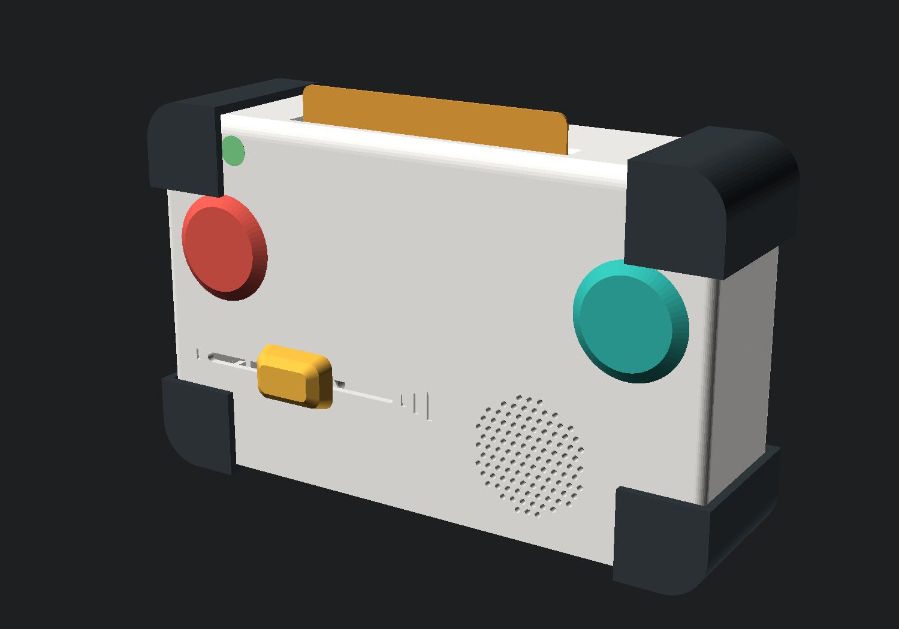
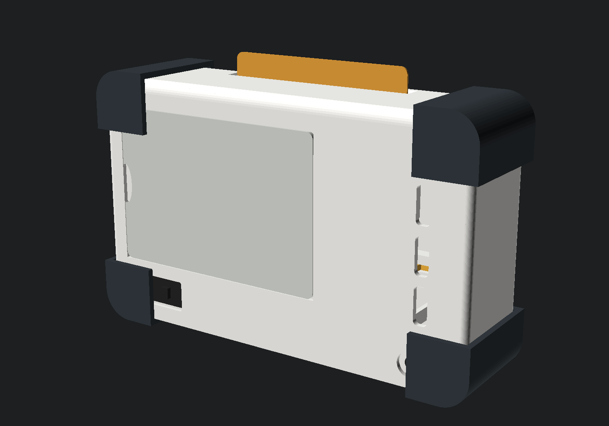
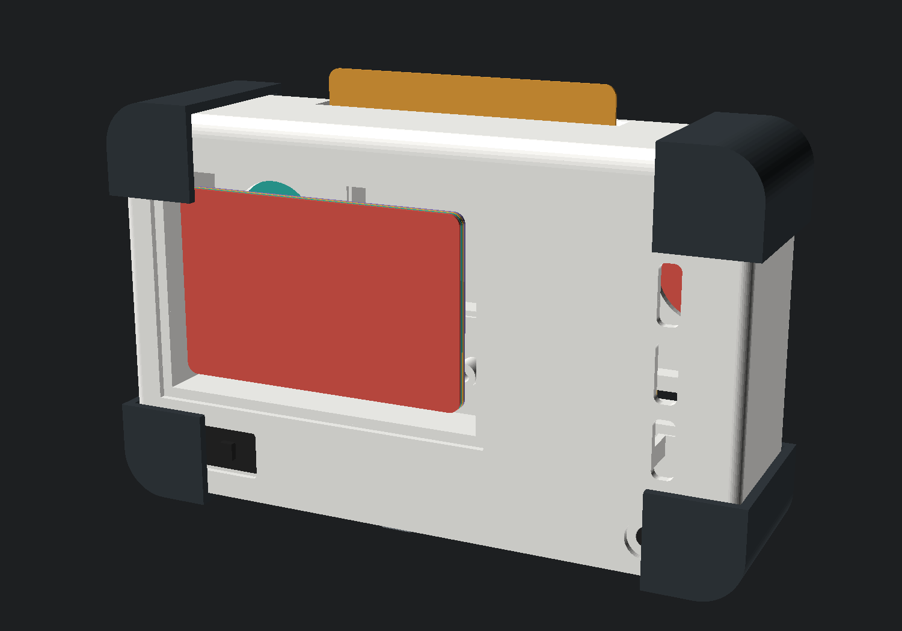

# Console da viaggio (v2) — alternativa al cubo

Stessa elettronica, stesso firmware, forma diversa: **180 × 110 × 45 mm**, si
tiene con due mani, carte e dischi si infilano in una fessura sul bordo
superiore, la collezione sta in un vano sul retro.

Nata dal documento `docs/varianti/v3-console-da-viaggio.md` del 18 ottobre e
modellata la sera stessa, perché la stampa non era ancora partita: adesso si
può scegliere con gli STL in mano invece che con un disegno.

## Come si infila la carta — il punto che decide tutto

La carta CR80 entra **di lato corto**: dentro 44 mm dei suoi 54, fuori un
centimetro per afferrarla.

Non è un dettaglio di comodità. L'antenna di una CR80 è una spira che corre
lungo tutto il bordo della carta: infilandola a metà, metà spira resta fuori
dal campo del lettore e la lettura diventa un'incognita. Con un centimetro
fuori la spira è tutta dentro, appoggiata all'antenna del PN5180. In più la
tasca è profonda 50 mm invece di 78, e dentro un corpo alto 110 mm è la
differenza fra «ci sta» e «non ci sta nient'altro».

Il disco Ø60 usa la stessa fessura: entra 50 mm, il tag centrale arriva
davanti all'antenna.

## I pezzi

| Pezzo | Misure | Stampa |
| --- | --- | --- |
| `scocca-v2` | 180 × 112 × 26 | faccia in giù, nessun supporto |
| `retro-v2` | 180 × 110 × 19 | faccia posteriore in giù |
| `coperchio-vano` | 103 × 70 × 4 | appoggiato, ganci in alto |
| `paracolpi-v2` | 4 angoli, 26 × 26 × 45 | in TPU 95A, 20 mm/s, retrazione a zero |
| `sportello-usb-v2` | 24 × 11 × 3,4 | appoggiata, bottoncino in alto |

Si riusano dal cubo: `pomello-cursore`, `culla-cursore`,
`camera-altoparlante`. La porticina della USB invece è sua: il bordo della
console è profondo 19 mm e la gola di quella del cubo ne vuole 16, che
lascerebbe due binari da un millimetro e mezzo. Le carte si comprano, i
dischi si stampano da `vinili/`.

## Scelte diverse dal cubo, e perché

**Il coperchio del vano è a scatto, non scorrevole.** Per scoprire
un'apertura da 96 mm una porticina scorrevole avrebbe bisogno di una corsa
più lunga della console. E un coperchio di 96 × 64 **non passa dal calibro
delle parti piccole** (Ø31,7): qui un pezzo removibile è sicuro, a differenza
del tappo della USB, che resta scorrevole proprio perché è piccolo.

**Serve un foglio di ferrite** dietro l'antenna. Vedi sotto: è la cosa più
importante da ricordare se si sceglie questa strada, e al cubo non serve.

**Nel vano carte e dischi stanno di piatto**, uno sull'altro, non in
piedi: il vano è profondo 13 mm e una CR80 in piedi ne vorrebbe 85,6. Sei
carte fanno 5 mm, tre dischi da 4 ne fanno 12 — la profondità è
dimensionata sui dischi. Per prenderne una si apre il coperchio e si
inclina la console: con cinque millimetri di margine il dito da solo non
passa, ma basta ribaltarla.

**La faccia e' divisa in due**: comandi a sinistra (cursore del volume in
basso, tasto, LED di stato in alto), griglia dell'altoparlante a destra. Sul
cubo la griglia sta al centro; qui al centro passa la tasca della fessura, e
spostandola a destra restano i 69 mm che il cursore del volume vuole per la
sua corsa.

**Il LED di stato** sta in alto a sinistra invece che al centro, per la
stessa ragione: la tasca della fessura occupa tutta la parte alta.

**Interruttore e tasto genitori stanno sul retro**, nella fascia sotto il
vano. Sul cubo sono sotto il fondo, dove la mano di un bambino non arriva
mentre gioca; qui un sotto non c'è, e il retro è la faccia che guarda il
tavolo quando la console è appoggiata. Per premere il tasto genitori
bisogna sollevarla: è esattamente il gesto che serve, e un bambino di due
anni che la ribalta trova un foro da 6 mm in un pozzetto, non un pulsante.

**Il tunnel della USB-C è più largo** che sul cubo (13 × 7,5 invece di
11 × 6). Sotto la presa passa l'ispessimento della gola della porticina,
quindi il connettore resta quattro millimetri dentro: deve entrarci il
guscio dello spinotto, non solo la punta.

## La ferrite, spiegata

Un foglio di ferrite è un adesivo nero, morbido, spesso mezzo millimetro:
polvere di ferrite in un legante. Non è uno schermo nel senso di una lamiera,
è una **scorciatoia per il campo magnetico**. L'antenna del PN5180 genera un
campo a 13,56 MHz che si chiude ad anello davanti e dietro il lettore. Le
linee che passano dietro non servono a niente, ma leggono lo stesso: un
foglio di ferrite appoggiato sul retro offre loro una strada a bassissima
riluttanza, le raccoglie e le rimanda avanti. Il risultato è doppio — più
portata davanti, quasi niente campo dietro.

Nel cubo non serve perché dietro l'antenna c'è solo aria e l'elettronica.
Nella console, invece, a 12–18 mm dietro l'antenna c'è il vano con sei carte:
senza ferrite il lettore ne vedrebbe una e farebbe partire una storia da solo,
col bambino che non ha appoggiato niente. È il motivo per cui questa variante
costa 5 € in più.

Come si monta, in pratica:

1. Ritagliarlo **5–10 mm più grande della spira** dell'antenna per ogni lato
   (la spira è il rettangolo di rame stampato sul PCB, non il bordo del
   modulo). Il nostro alloggiamento è 60 × 50 mm.
2. Incollarlo sul **retro** del PCB dell'antenna, lato componenti. Se qualche
   componente sporge, prima un giro di Kapton: la ferrite conduce poco, ma non
   è un isolante.
3. Infilare il tutto nella sede stampata (`sedi_antenna`), che tiene il
   pacchetto PCB + ferrite a 14,4 mm dalla faccia, cioè appoggiato alla
   parete della tasca.
4. Provare **prima** di chiudere: carta inserita per 44 mm deve leggere,
   carta nel vano sul retro non deve leggere. Sono due minuti col provino.

Marche che vanno bene: qualsiasi «ferrite sheet NFC / anti-metal», 0,3–0,5 mm.
Quelle da ricarica wireless (Qi, 100–200 kHz) sono un materiale diverso e
rendono meno a 13,56 MHz, ma funzionano: se è quello che arriva, va provato.

## Cosa manca ancora, se la scegliamo

Dei cinque punti aperti del primo giro ne restano due, e sono i due che si
chiudono solo con i pezzi in mano:

- [x] **Sostegni interni**: fatti. Cornice e sede della ferrite per il
      PN5180, culla della batteria divisa fra i due gusci (il portabatteria
      resta stretto quando si chiude, più due asole per una fascetta),
      quattro colonnine per la basetta 36 × 80, sede del TP4056 allineata
      alla presa, culla e collare del cursore.
- [x] **Angoli in TPU**: `paracolpi-v2.stl`, quattro pezzi da infilare sugli
      spigoli.
- [x] **Verifica degli ingombri**: `verifica-ingombri.py` confronta ventuno
      volumi a coppie e contro il guscio. Oggi dà zero problemi; ha trovato
      cinque collisioni che nei render non si vedevano (la tasca che
      tagliava la camera acustica, la batteria che in orizzontale non ci
      stava, la culla del cursore fuori dal guscio, il cursore contro il
      braccio della culla della batteria, il pozzetto del tasto genitori
      sopra una vite d'angolo). Va rilanciato dopo ogni modifica ai
      parametri, e rifatto col calibro quando arrivano i pezzi veri.
- [ ] **Pulizia della fessura**: oggi la tasca è chiusa in fondo. Un bambino
      ci infila briciole, e per toglierle bisogna aprire i due gusci. Va
      deciso se farci un'uscita.
- [ ] **La prova che conta**: una CR80 inserita per 44 mm si legge, e una
      carta nel vano sul retro resta zitta? Si misura col provino NFC appena
      arrivano PN5180 e ferrite, in dieci minuti.

## Com'è fatta, in due immagini

| | |
| --- | --- |
|  |  |
| Dietro, chiuso: coperchio, interruttore, pozzetto del tasto genitori | Dietro, aperto: sei carte di piatto, una sull'altra |

I render escono da `sorgenti/scena-colori.scad`, che monta gli stessi file
degli STL insieme ai componenti comprati. Se cambia un pezzo cambiano
anche le immagini:

    openscad -o immagini/col-fronte.png --imgsize=1500,1050 \
      --camera=0,20,55,72,0,32,460 --projection=p \
      --colorscheme="Tomorrow Night" sorgenti/scena-colori.scad

## Come si sceglie

| | Cubo (v1) | Console (v2) |
| --- | --- | --- |
| Pronto a stampare | **sì**, 13 STL verificati | **sì**, 4 STL, ingombri verificati |
| Gesto | appoggi la carta sul vassoio | la infili nella fessura |
| Collezione | due raccoglitori ai lati, 6+6, in vista | vano sul retro, 6 carte o 3 dischi, di piatto |
| In viaggio | i raccoglitori si sfilano e si perdono | tutto dentro |
| Sul tavolo | sta fermo, il bambino lo guarda dall'alto | va tenuto o appoggiato di piatto |
| Rischi aperti | nessuno grosso | lettura a 44 mm, briciole nella fessura |
| Componenti in più | — | ferrite (~5–9 €) e 20 g di TPU |

Il cubo resta la scelta prudente: è lo stesso progetto da più giorni e
qualcuno di quei millimetri è già stato ricontrollato due volte. La console
adesso è pari come completezza — sostegni, paracolpi, ingombri verificati —
ed è più bella da portare in giro, ma porta con sé due incognite che si
chiudono solo col PN5180 sul tavolo. Entrambe si risolvono in un pomeriggio
appena arrivano i pezzi: non serve decidere oggi, serve ordinare la ferrite
insieme al resto per potersi tenere la porta aperta.
